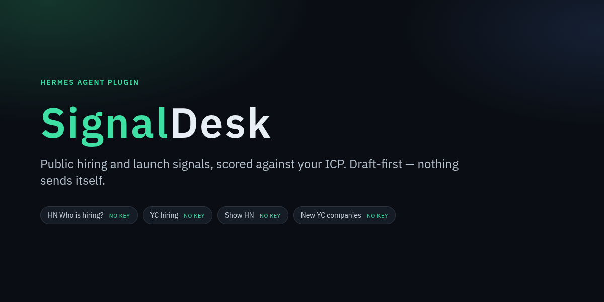
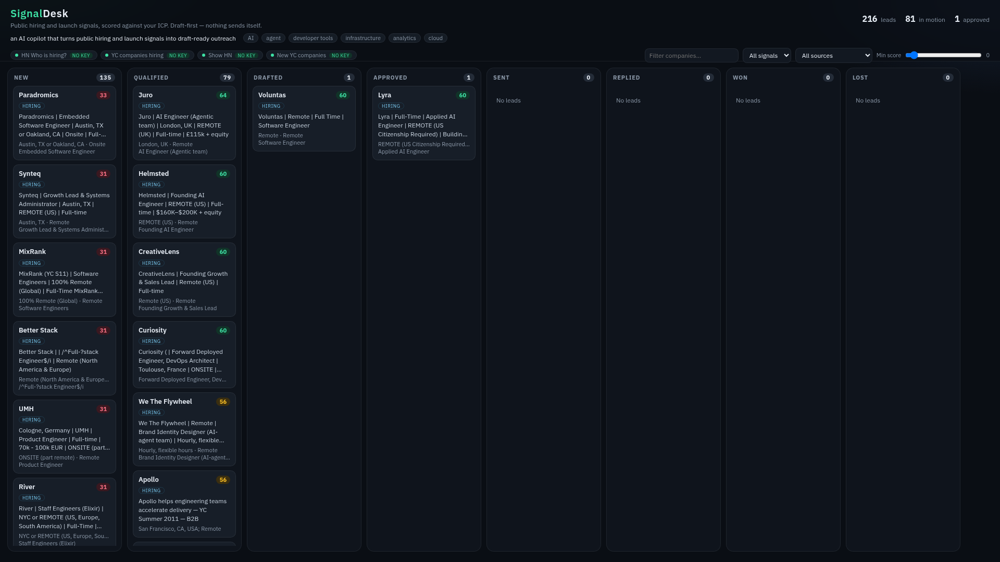
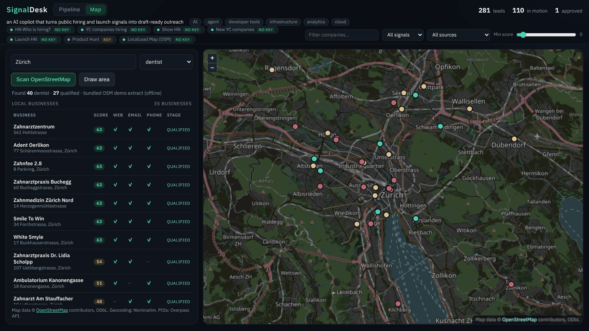
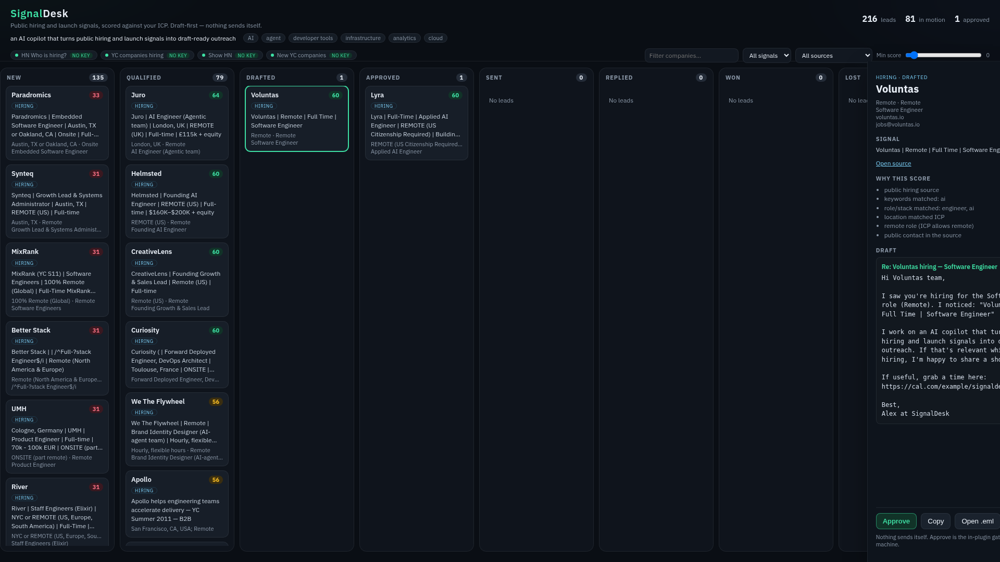

# SignalDesk

<p align="center">
  
</p>

A [Hermes Agent](https://github.com/NousResearch/hermes-agent) plugin that turns **public hiring and launch signals** and **local businesses on an OpenStreetMap map** into one scored, draft-first outreach queue.

Install it, describe your ICP, scan, review the board, approve one lead. **Nothing is sent unless you approve it** from the board, Desktop, or `/signaldesk approve <id>`. The model cannot approve a lead. Cron jobs and unattended runs fail closed.

<p align="center">
  
</p>

<p align="center">
  
</p>

<p align="center">
  
</p>

## Why this beats a skill

A skill can remind the model to “go look at Who is hiring and write some emails.” It cannot keep a pipeline, it cannot stop a cron job from sending, and it will not still work when the model forgets the policy.

SignalDesk is a plugin, not a prompt:

- **Tools** for ICP, scan, **map scan**, list, draft, mark, follow-ups, CSV, sources, a local `.eml`, and the HTML board. Approval is user-only (board, Desktop, or `/signaldesk approve <id>`)
- A **`pre_tool_call` hook** that blocks send-like tools unless the lead is approved (or later); all sends are blocked during cron/unattended runs
- A **slash command** (`/signaldesk`) and a weekday **catch-up blueprint** that only scans and summarizes
- A **SQLite pipeline** with domain dedup and transparent scores
- An **interactive HTML board** with a Pipeline view and an **OpenLayers Map view** (what the demo records), and a **Hermes Desktop page** (`desktop/plugin.js`, OpenLayers bundled) that talks to the same backend

## Install

```bash
hermes plugins install codeybot-labs/signaldesk
hermes plugins enable signaldesk
```

After it is listed in the official catalog:

```bash
hermes plugins install signaldesk
```

Requires Hermes `>= 0.22.0`. No paid APIs and no plugin-side model key. Drafts use the host LLM when Hermes provides `ctx.llm`, and a local template otherwise.

Optional Desktop: enable the plugin, then **Capabilities → Plugins → Rescan** so the SignalDesk sidebar page can load. The Desktop half (including the Map tab) was validated (`desktop surface` passed) but not clicked through in a live Desktop window on the build machine.

## Quick start

Example prompts:

```
Set my SignalDesk ICP: I sell an AI copilot for B2B sales teams.
Keywords: AI, agents, developer tools, infrastructure. Remote is fine.
Then scan hiring and launch sources and show me the top qualified leads.
```

```
Draft the top qualified SignalDesk lead, show me the score reasons,
and wait — don't approve until I've read the draft.
```

```
Find dentists in Zürich on the SignalDesk map. I sell a booking assistant
for clinics (set business_types=dentist). Draft the best one, don't approve.
```

```
/signaldesk status
```

Offline, with bundled fixtures (no network):

```bash
./demo/run_demo.sh
python3 demo/serve_demo.py
# open http://127.0.0.1:8765/board.html
```

Click a card for score reasons, the public quote, and the draft. **Approve**, **Copy**, and **Open .eml** call local handlers. Nothing is emailed.

Switch to **Map**, type a city and pick a business type (or **Draw area** to drag a box), then click a pin or a table row to open the same panel. Offline, the map uses the bundled Zürich extract in `geodata/`.

## Sources (v0.2)

| id | Signal | Source | Key? |
|---|---|---|---|
| `hn_hiring` | Hiring | Official HN “Who is hiring?” thread via [Algolia HN Search](https://hn.algolia.com/api) | No |
| `yc_hiring` | Hiring | [yc-oss](https://yc-oss.github.io/) `api/companies/hiring.json` | No |
| `hn_show` | Launch | Recent Show HN posts via Algolia | No |
| `yc_launches` | Launch | yc-oss `api/changes/latest.json` (`added` only) | No |
| `hn_launch` | Launch | “Launch HN” posts (YC companies introducing themselves) via Algolia | No |
| `producthunt` | Launch | Official Product Hunt GraphQL v2 | Optional `PRODUCTHUNT_TOKEN` |

| `osm_map` | Local | **LocalLead Map**: OpenStreetMap businesses via [Overpass API](https://wiki.openstreetmap.org/wiki/Overpass_API), geocoded with [Nominatim](https://nominatim.org/). On demand through `signaldesk_map_scan` | No |

`signaldesk_sources` reports enablement and rate-limit notes. Product Hunt stays **off** until you set the token through Hermes `secret_scope`. **Product Hunt API terms restrict commercial use** without permission — only enable that source if your use is allowed.

BetaList is **not** shipped. Their site terms limit copying and commercial or public reuse of their materials, and API access is case-by-case, so a keyless RSS source would not be a clean fit.

A live scan (11 Nov 2026, Asia/Calcutta) reached current Algolia HN threads, the yc-oss hiring snapshot (~1498 companies), Show HN, and the changes feed (2 new companies that day). Each scan caps how many records it keeps per source so a 1,498-company hiring dump does not flood the board.

## LocalLead Map

`signaldesk_map_scan` takes a **city + business type** (`dentist`, `cafe`, `restaurant`, `gym`, `lawyer`, `accountant`, `hairdresser`, `bakery`, `coworking`, … or a raw OSM tag such as `craft=brewery`) **or a bbox** (`south,west,north,east`, what *Draw area* sends).

1. **Geocode** the city with Nominatim (only when no bbox is given).
2. **Query Overpass** for named nodes/ways with that tag in the area (capped at 80, `out center tags`).
3. **Normalize** each business: name, address, website, email, phone, opening hours, OSM link and coordinates.
4. **Score** with the same ICP: business type in `business_types` (+20), website (+12), public email (+12), phone (+6), opening hours (+3), exclusions (−40), MX.
5. **Upsert** into the same SQLite pipeline (dedup by domain, OSM id or email). From here it is the normal flow: draft → approve → local `.eml`. Drafts cite the OSM listing and the business’s own site, and use `local_offer` if you set one.

Being a good OSM citizen:

- **Nominatim policy:** at most **1 request per second** (process-wide lock), identifying User-Agent `SignalDesk-Hermes-plugin/0.2.0 (+https://github.com/codeybot-labs/signaldesk)`, results **cached 30 days** in the plugin’s SQLite store. No autocomplete, no bulk geocoding.
- **Overpass:** one request at a time, `[timeout:25]`, result cap, results **cached 7 days**. Default instances: `overpass-api.de`, then `overpass.kumi.systems`. Override with `SIGNALDESK_OVERPASS_URL` (comma-separated), e.g. the Swiss instance `https://overpass.osm.ch/api/interpreter` (Switzerland only), which the demo uses.
- **Fallback:** if you are offline or every instance fails, the scan uses the small bundled extract in [`geodata/`](geodata/README.md) (real OSM data for Zürich dentists and cafés, fetched 11 Nov 2026, with the query recorded) and says so in the result (`mode: demo`).
- **Basemap:** standard OSM tiles (`tile.openstreetmap.org`) loaded by the browser while you look at the map, under the [tile usage policy](https://operations.osmfoundation.org/policies/tiles/). No prefetching.
- **ODbL attribution:** “© OpenStreetMap contributors, ODbL” is on the map, in the table, in the lead panel, in every CSV row from OSM (plus a footer row), and as an `X-SignalDesk-Data-Attribution` header in `.eml` files. Keep it when you share derived lists; a database you redistribute built from OSM data is share-alike under ODbL.

## Follow-ups and exports

- `signaldesk_followups` lists **sent** leads with no reply after `followup_days` (ICP, default 5), with `days_since_contact`. After you follow up, `signaldesk_mark` with `followed_up: true` resets the timer.
- `signaldesk_export_csv` writes the pipeline (optionally one stage or signal type) with score, stage, contact, phone, website, coordinates, source URL, approval/sent times and attribution.
- `signaldesk_prepare_send` writes an RFC 5322 `.eml` (and a `mailto:` link) for an **approved** lead only. It does not send.

## Safety model

- **Draft-first.** Tools write drafts only. Approval is user-only (the board, Desktop, or `/signaldesk approve <id>`) and still does not send. The model cannot call an approve tool, and `signaldesk_mark` refuses `stage=approved` and refuses moving a not-yet-approved lead to `sent`/`replied`/`won`.
- **Sending is a separate, explicit step.** `signaldesk_prepare_send` writes a local `.eml` and a `mailto:` link. There is no third-party mail API.
- **`pre_tool_call` gate.** Send-like tools (`send_email`, SMTP, Gmail, …) are blocked unless a matching lead is already approved (or later).
- **Cron fail-closed.** If `ctx.current_cron_execution()` is set, sends are blocked even for approved leads. The catch-up blueprint only scans and summarizes.
- **Public signals only.** No commit-email harvesting, no SMTP probing (MX is DNS UDP only), no scraping the YC HTML site.

## Tools

| Tool | Purpose |
|---|---|
| `signaldesk_set_icp` | Save ICP (keywords, offer, booking link, thresholds) |
| `signaldesk_scan` | Fetch, score, upsert (hiring + launch sources) |
| `signaldesk_map_scan` | LocalLead Map: OSM businesses for a city + type or a bbox → scored leads |
| `signaldesk_list` | Filter by stage or signal type |
| `signaldesk_draft` | Write a draft, move to `drafted` |
| `signaldesk_prepare_send` | Write a local `.eml` + mailto for an **approved** lead |
| `signaldesk_mark` | `sent` / `replied` / `won` / `lost`, notes, `followed_up` (refuses `stage=approved`) |
| `signaldesk_followups` | Sent leads due a follow-up, with days since contact |
| `signaldesk_export_csv` | CSV under the plugin data dir |
| `signaldesk_sources` | List sources, including optional ones that are off |
| `signaldesk_board` | Regenerate the HTML board |

Approval is not a model tool: use the board or Desktop **Approve** button, or `/signaldesk approve <id>`.

Stages: `new → qualified → drafted → approved → sent → replied / won / lost`.

## Disclosures (catalog rule 13)

- **Network:** HTTPS GET to Algolia HN Search and `yc-oss.github.io`. For the map, only when you run a map scan: HTTPS GET to Nominatim (`nominatim.openstreetmap.org`, ≤1 req/s, cached) and HTTPS POST to an Overpass API instance (one at a time, cached); the board/Desktop map loads OSM tiles from `tile.openstreetmap.org` in the browser. Optional DNS MX lookups over UDP (no SMTP banner or RCPT probing). Optional HTTPS POST to Product Hunt GraphQL v2 only when `PRODUCTHUNT_TOKEN` is set. No third-party mail APIs. No telemetry.
- **Data:** Leads and ICP live in `$HERMES_HOME/plugin-data/signaldesk/` (override with `SIGNALDESK_DATA_DIR`). Nothing in this repo is a credential store.
- **Credentials:** None required for the core sources. The optional Product Hunt token is `optional_env` / `secret_scope` (`PRODUCTHUNT_TOKEN`), never required to install or scan the keyless feeds.
- **LLM:** Drafts call `ctx.llm` when the host provides it, otherwise a template. No plugin-side model signup.
- **Sending:** SignalDesk does not send mail. After approval you open the `.eml`, use the mailto link, or a Hermes email tool, which the hook still gates.
- **OpenStreetMap:** Map data © OpenStreetMap contributors, licensed under the [ODbL 1.0](https://opendatacommons.org/licenses/odbl/). Attribution is shown on the map and written into CSV and `.eml` exports. `geodata/` ships a small real OSM extract (ODbL) for offline use.
- **Bundled code:** OpenLayers 10.5.0 (BSD-2-Clause) in `assets/vendor/ol/` and inlined into `desktop/plugin.js` by `scripts/build_desktop.py` (its JSONP loader is stubbed out; nothing else is changed).
- **Sources:** Public comments and public directory snapshots only. We do not republish the yc-oss corpus. Attribute HN, YC, yc-oss, and (if enabled) Product Hunt when you share derived lists.
- **Offline / fixtures:** Tests and `demo/run_demo.sh` read `tests/fixtures/` when `SIGNALDESK_OFFLINE=1`. Live scans need outbound HTTPS.

## Development

```bash
SIGNALDESK_OFFLINE=1 SIGNALDESK_SKIP_MX=1 python -m pytest -q
hermes plugins validate . --install-deps
hermes plugins doctor --ci
python3 scripts/build_desktop.py   # after editing scripts/desktop-src/*.js
```

Python 3.10+, stdlib only for the plugin core (urllib + sqlite3 + a tiny DNS MX client). The map UI is OpenLayers (vendored, no CDN). The optional Desktop/dashboard backend uses FastAPI, which Hermes already provides.

## License

MIT. See [LICENSE](LICENSE).
